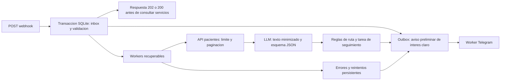

# Flujo de leads · Clínica Dental Cerro Alto

Implementación de la Parte A en Python 3.11+ y SQLite. Recibe el evento, lo guarda antes de responder, normaliza contactos, consulta pacientes con paginación, clasifica con un LLM compatible con OpenAI, valida su JSON y conserva una tarea por persona identificada. Los avisos operativos usan Telegram; no se envían mensajes reales a pacientes.

**Estado verificado el 16/10/2026:** 37 pruebas automatizadas aprobadas. Con autorización del usuario se cambió el modelo saturado por Gemini `gemini-3.5-flash-lite`, usando la misma clave y endpoint de Google. Los diez payloads completaron dos pasadas con API de pacientes, LLM y Telegram reales: 20 entregas, nueve eventos únicos, ocho leads y cuatro avisos calientes enviados, sin avisos duplicados en la segunda pasada. No hubo errores del LLM; tres fallos transitorios de la API de pacientes se recuperaron y notificaron. Se verificó además el recorrido Telegram envío → respuesta humana con código → recepción → confirmación automática. El lead fallido con el modelo anterior ya se recuperó. El código se publica en este fork. Sigue pendiente el enlace real de agenda; no se entregó la etapa en la plataforma.

## 1. Instalar desde cero

Requisitos: Git, Python 3.11 o superior con `pip` y `venv`. No requiere n8n, Docker, servidor de base de datos ni servicios de pago obligatorios. El proveedor LLM que elijas debe tener saldo o acceso de prueba disponible: este proyecto no incluye créditos.

Clona este fork y entra en su carpeta:

```bash
git clone https://github.com/josuealejandroma-web/cerro-alto-leads.git
cd cerro-alto-leads
```

Crea el entorno:

```bash
python -m venv .venv
```

Activa el entorno:

```powershell
# Windows PowerShell
.\.venv\Scripts\Activate.ps1
```

```bash
# macOS / Linux
source .venv/bin/activate
```

Si Windows bloquea la activación, usa `.\.venv\Scripts\python.exe` en lugar de `python` en cada comando. No hace falta cambiar políticas del equipo.

```bash
python -m pip install -r parte-a/requirements.txt
```

Copia `.env.example` a `.env` en la raíz (`Copy-Item .env.example .env` en PowerShell; `cp .env.example .env` en macOS/Linux) y completa:

| Variable | Valor requerido |
|---|---|
| `PATIENTS_API_BASE_URL` | Base entregada por la prueba, sin anexar `/v1/pacientes`. |
| `PATIENTS_API_TOKEN` | Token personal de la prueba. |
| `LLM_BASE_URL` | Base de la API compatible, incluyendo `/v1` cuando corresponda. |
| `LLM_API_KEY` | Clave del proveedor elegido. |
| `LLM_MODEL` | Nombre exacto de un modelo habilitado en tu cuenta. |
| `LLM_RESPONSE_FORMAT` | `json_schema` por defecto; `json_object` si tu proveedor solo soporta ese formato. Ambos se validan localmente. |
| `TELEGRAM_BOT_TOKEN` | Token de un bot creado con BotFather. |
| `TELEGRAM_CHAT_ID` | Chat de recepción que ya inició conversación con el bot o grupo donde el bot tiene permiso. |
| `AGENDA_URL` | Enlace real de agenda de la clínica, si está disponible. |

El resto de variables tiene valores por defecto documentados en `.env.example`. No copies credenciales al README, capturas públicas o commits.

La configuración validada usa `LLM_BASE_URL=https://generativelanguage.googleapis.com/v1beta/openai` y `LLM_MODEL=gemini-3.5-flash-lite`, mediante la [API compatible de Gemini](https://ai.google.dev/gemini-api/docs/openai). El modelo se eligió entre los disponibles con la misma clave, después de probar clasificaciones y el flujo completo. `HTTP_TIMEOUT=20` permite esperar al proveedor en segundo plano y sigue siendo menor que el lease de 45 segundos. Los reintentos permanecen activos; ninguna prueba puntual garantiza ausencia de futuras interrupciones del proveedor.

## 2. Arrancar el flujo real

```bash
python parte-a/app.py --check-config
python parte-a/app.py
```

`--check-config` solo comprueba presencia de configuración; no prueba credenciales. Las pruebas reales se hacen enviando los ejemplos y revisando estados y avisos. Con configuración incompleta, el servidor conserva eventos y registra errores recuperables, pero no se considera funcionando de punta a punta.

- Webhook: `POST http://127.0.0.1:8080/webhook`.
- Consulta: `GET http://127.0.0.1:8080/leads/estado?event_id=evt_...`.
- Listado: `GET http://127.0.0.1:8080/leads/estado?desde=2026-11-03T00:00:00Z`.
- Salud local: `GET http://127.0.0.1:8080/health`.

El brief permite levantarlo en la máquina del evaluador: no hace falta una URL pública. Si se conecta el conector real, necesita una URL HTTPS accesible que reenvíe a `/webhook`. Para escuchar fuera de localhost configura `HOST=0.0.0.0`, un proxy HTTPS y `QUERY_TOKEN`. El endpoint de consulta remoto requiere `Authorization: Bearer <QUERY_TOKEN>`; entregar ese acceso al evaluador de forma privada. No se presume una firma del conector porque su contrato no la incluye.

## 3. Probar

### Pruebas sin claves ni llamadas externas

```bash
python -m unittest discover -s parte-a/tests -v
```

La suite usa HTTP real hacia dobles locales de API, LLM y Telegram, con bases temporales aisladas. Cubre los diez archivos originales, JSON y tipos inesperados, duplicados concurrentes, teléfonos internacionales, correo como único contacto, paginación de pacientes y tratamientos, 401/429/503, recuperación, salida LLM inválida, prompt injection, avisos fallidos, persistencia y minimización de datos. **No certifica un modelo real ni una entrega real de Telegram.**

### Demostración completa con servicios simulados

En una terminal:

```bash
python parte-a/demo.py
```

En otra terminal con el mismo entorno activado:

```bash
python parte-a/verificar_payloads.py http://127.0.0.1:8080
```

Usa `data/demo.sqlite3`, proveedores simulados y ningún secreto. No ejecutar al mismo tiempo que `app.py` en el mismo puerto. Las coincidencias de pacientes de la demo son ficticias para probar paginación y tratamientos pendientes; no son resultados de la API de evaluación.

### Prueba contra API, LLM y Telegram reales

Con `.env` completo y `app.py` ejecutándose:

```bash
python parte-a/verificar_payloads.py http://127.0.0.1:8080 --timeout 180
python parte-a/cli.py avisos
python parte-a/cli.py tareas
```

El verificador envía los diez payloads originales, comprueba respuesta antes de diez segundos, consulta hasta un estado final y verifica el contrato, contactos, duplicados y rutas. Un tratamiento pendiente puede elevar un caso informativo a caliente; eso se exige justificar con el motivo registrado. Revisa además que los avisos estén `enviado`, sus marcas de tiempo y su recepción en Telegram. El script falla si hay errores o trabajos pendientes: no los cuenta como resultados exitosos.

El script original también se conserva:

```bash
python enviar_payloads.py http://127.0.0.1:8080/webhook
```

### Comprobar envío y recepción de Telegram

```bash
python parte-a/telegram_check.py --code CODIGO-UNICO-DE-PRUEBA --send --wait 120
```

Envía la petición al chat configurado. Una persona debe escribir ese mismo código al bot; el comando lo recibe mediante `getUpdates` y devuelve una confirmación por Telegram. Solo acepta el chat de `.env` y el código exacto. No imprime conversaciones, no cambia webhooks y no confirma ni elimina actualizaciones ajenas. Si ya hay un webhook activo, se detiene de forma explícita para preservarlo. Es una herramienta de diagnóstico, no un chatbot conversacional permanente.

## 4. Consultar, revisar y recuperar

```bash
python parte-a/cli.py estado --event-id evt_01JB7Q3M2X4K8R9T5W6Y
python parte-a/cli.py estado --desde 2026-11-03T00:00:00Z
python parte-a/cli.py detalle --event-id evt_01JB7Q3M2X4K8R9T5W6Y
python parte-a/cli.py metricas
python parte-a/cli.py revision
python parte-a/cli.py avisos
```

La consulta HTTP y `cli.py estado` devuelven exactamente las ocho claves del brief. Un evento desconocido da HTTP 404. `desde` usa las entregas recibidas localmente y requiere una fecha ISO 8601 con zona horaria; incluye registros sin `event_id`, cuyo valor es `null`, y eventos antiguos que volvieron a llegar desde ese momento. Cada evento aparece una sola vez. Los campos aún desconocidos son `null`. `cli.py tareas` muestra una tarea por lead con contacto, borrador y propuesta para recepción; su salida contiene datos personales y es solo para operación local autorizada.

Estados: `pendiente`, `procesando`, `procesado`, `duplicado`, `rechazado`, `error`. Un reintento del mismo `event_id` devuelve el registro original. Un nuevo evento de una misma persona identificada tiene `duplicado_de` igual al `event_id` inicial y comparte `lead_id`; se analiza para no perder un interés nuevo o una urgencia posterior.

Después de corregir una clave, una dependencia o una caída:

```bash
python parte-a/cli.py reintentar --event-id evt_01JB7Q3M2X4K8R9T5W6Y
python parte-a/cli.py reintentar-avisos
```

El intento real controlado original ya se recuperó con el nuevo modelo y quedó `procesado` como tibio. Para inspeccionarlo en su base separada:

```powershell
# PowerShell
$env:DB_PATH="data/live-check.sqlite3"
python parte-a/cli.py estado --event-id evt_01JB7R7F4K6M8P0R2T4V6D
```

La comprobación controlada limitó esa ejecución a dos intentos. El servicio normal conserva los cuatro intentos configurados por defecto. Las bases y sus contenidos no se incluyen en el ZIP ni en Git.

Los comandos reencolan; los workers del servidor hacen el procesamiento. Un fallo no obliga a reenviar el webhook. Los trabajos cuyo proceso se interrumpió vuelven a ser elegibles al vencer su lease (45 segundos por defecto). No borres la base para reintentar.

Los rechazados quedan en `revision`, con motivo y `receipt_id`, y su entrada original queda en SQLite. Para corregir un rechazado, un operador debe revisar el contenido y enviar un evento nuevo con un `event_id` nuevo, conservando la referencia al original en su registro de revisión. El comando de reintento solo actúa sobre fallos técnicos, no vuelve válido un contacto incorrecto.

## 5. Flujo y decisiones de seguridad



- Una transacción confirma evento, entrega y aviso preliminar antes del 2xx. Si falla SQLite, devuelve 503 para activar los reintentos del conector y trata de avisar directamente por Telegram.
- Teléfono o correo válido es suficiente. El nombre vacío, un mensaje vacío, emojis o un idioma extranjero no son basura. Se asume región EC solo para teléfonos nacionales sin prefijo internacional, porque el formulario procede de campañas de una clínica ecuatoriana; una ciudad distinta no cambia el país del teléfono. La advertencia de este supuesto está en `DECISIONES.md`.
- Las consultas usan `urlencode` para codificar `+` como `%2B`. Un límite persistente de 2,1 segundos entre solicitudes respeta las 30 por minuto y la espera indicada por 429. Cada página se guarda antes de avanzar; un reinicio no obliga a empezar toda la paginación.
- La API busca con OR. Se revisan todas las páginas y se requiere contacto coincidente más nombre compatible, o ambos contactos coincidentes cuando falta nombre. Varias coincidencias plausibles quedan ambiguas: no se adjunta historia de otra persona.
- Urgencia, petición explícita de cita e intención clara de iniciar un tratamiento de alto valor pueden generar aviso preliminar antes de la API y del LLM. El aviso no confirma cita ni diagnóstico. Los tratamientos pendientes o en curso elevan el lead a caliente cuando se identifican.
- La salida LLM se valida con JSON Schema antes de usarla. Los errores, rechazos del modelo o respuestas truncadas permanecen recuperables. Para descartar por spam se exige evidencia explícita más clasificación concordante; la duda queda tibia.
- Cada persona identificada tiene una tarea y una clave única de aviso caliente. Un duplicado puede elevar la prioridad de esa tarea, pero no crea otra llamada. Telegram no ofrece idempotencia de `sendMessage`: un timeout después de enviar puede producir un aviso duplicado al reintentar; no se promete entrega exactamente una vez.
- Los logs solo contienen referencias internas y códigos controlados. El LLM recibe el mensaje con redacción de contactos e identificadores y el servicio declarado, sin nombre estructurado ni resultados de la API de pacientes. La redacción automática no garantiza anonimización completa de texto libre.
- HTTPS usa `truststore` para consultar la confianza de certificados del sistema operativo. Esto resolvió una cadena de certificados que el contexto TLS inicial de Python no reconocía al conectar con Telegram. Se mantienen obligatorias la validación del certificado y del nombre de host; no se desactiva TLS para sortear errores.
- Telegram recibe referencias internas y acciones operativas, sin teléfonos, nombres ni historia clínica. Recepción consulta los detalles en la herramienta local protegida.
- SQLite conserva el original para auditoría y recuperación y contiene datos personales. Limita permisos del archivo y copias de seguridad al personal autorizado, usa cifrado de disco y acuerda retención antes de usar datos reales. No se implementa cifrado propio ni se afirma que un plan gratuito resuelva por sí solo las condiciones de tratamiento de datos de un proveedor.

## 6. Agenda, fecha solicitada y límites conocidos

El usuario indicó **18/10/2026** como fecha de ejemplo. Es domingo. El material recibido no incluye las tablas completas de horarios por sede, duraciones ni un enlace real de agenda. Esa fecha **no se convierte en una reserva**.

Con `AGENDA_URL` configurada se guarda y redacta una propuesta de agendamiento mediante ese enlace. Sin ella, se guarda una solicitud para coordinar con recepción, sin inventar fecha/hora. **Esta alternativa aún no satisface plenamente el requisito de enlace de agenda o cita tentativa:** falta completar un enlace válido o los datos de agenda antes de entregar la Parte A. No hay API de disponibilidad o reserva en la documentación de pacientes.

Los avisos preliminares reducen la demora de solicitudes claras, pero un pico de 150 leads que requieran varias páginas de la API puede superar cinco minutos para descubrir todos los tratamientos pendientes. El watchdog avisa por trabajos demorados (120 segundos) y avisos prioritarios cercanos al plazo (240 segundos). No se garantiza un SLA absoluto si los proveedores o Telegram están caídos.

El aviso por ausencia de entradas está desactivado por defecto para no alertar sin conocer horarios y campañas. Puede configurarse con `SILENCE_SECONDS`, pero no reemplaza una conciliación con Meta. Lo que nunca llega al webhook no puede recuperarse desde este sistema ni desde el conector.

Se usa un solo servidor/proceso y una base local persistente; no se implementa alta disponibilidad. El body se limita a 256 KiB. Los listados de estado no paginan porque el contrato del evaluador pide una lista completa. No hay interfaz web de administración ni envío real a pacientes.

## Archivos

`parte-a/` contiene servicio, reglas, almacenamiento, integraciones, prompts, esquema, CLI, demo, verificador de payloads, diagnóstico de Telegram y tests. `payloads/` y `enviar_payloads.py` conservan el material base. `DECISIONES.md` registra supuestos y alcance; `AI_WORKLOG.md` documenta el uso de IA. `.env`, bases de datos y entornos virtuales están excluidos de Git.

Referencias de integración: [Structured Outputs de OpenAI](https://developers.openai.com/api/docs/guides/structured-outputs), [compatibilidad de Gemini](https://ai.google.dev/gemini-api/docs/openai), [Telegram sendMessage](https://core.telegram.org/bots/api#sendmessage) y [Truststore](https://truststore.readthedocs.io/en/latest/).
