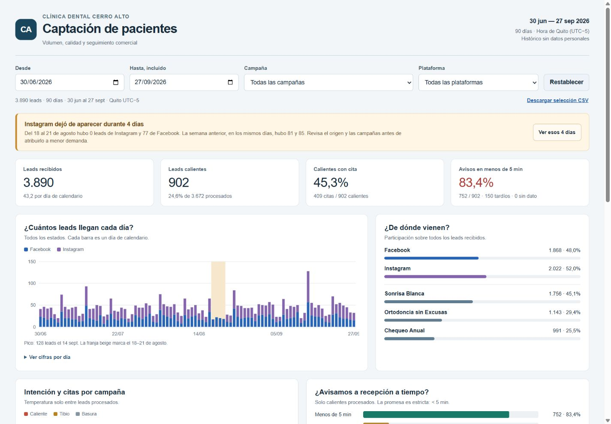
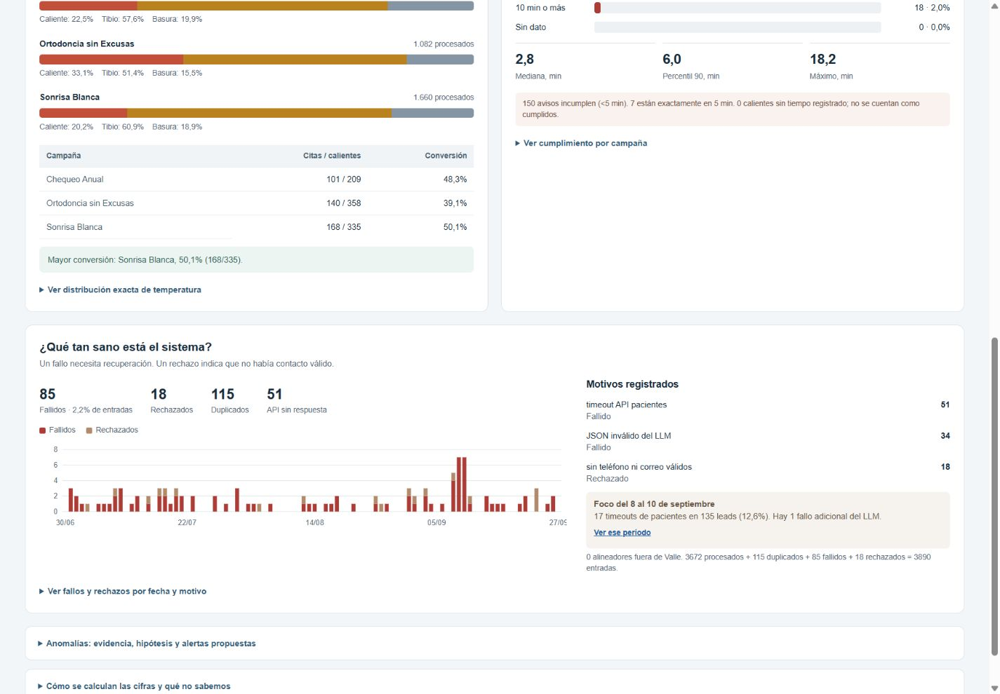
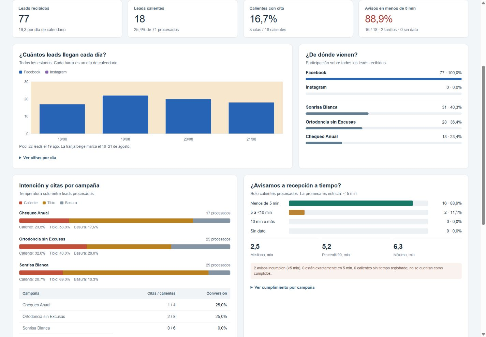

# Dashboard de captación · Clínica Dental Cerro Alto

Abre [index.html](index.html) en un navegador moderno. Funciona sin servidor, sin conexión y sin instalar dependencias. Los filtros de fecha, campaña y plataforma actualizan los indicadores, las gráficas y las tablas. El botón «Descargar selección CSV» exporta las filas visibles. Los botones de las anomalías llevan a sus fechas; «Restablecer» vuelve a los 90 días.

Si GitHub muestra el código en vez del dashboard, descarga esta carpeta y abre `index.html`. El CSV entregado por la prueba no contiene datos personales.

## Capturas







## Respuestas principales

| Indicador | Resultado del histórico completo |
|---|---:|
| Entradas registradas | 3.890 en 90 días, 43,2 por día de calendario |
| Plataformas | Facebook 1.868; Instagram 2.022 |
| Estados | 3.672 procesados; 115 duplicados; 85 fallidos; 18 rechazados |
| Temperatura entre procesados | 902 calientes; 2.103 tibios; 667 basura |
| Calientes que registran cita | 409 / 902 = 45,3% |
| Aviso en menos de 5 minutos | 752 / 902 = 83,4% |
| Avisos que incumplen | 150 con tiempo ≥5 min, incluidos 7 exactamente en 5 min |
| Tiempos de aviso ausentes | 0 entre 902 calientes |
| Mediana / percentil 90 / máximo de aviso | 2,8 / 6,0 / 18,2 minutos |
| Motivos de fallo | 51 timeouts de API; 34 JSON inválidos del LLM |
| Rechazos | 18 sin teléfono ni correo válidos |

| Campaña | Entradas | Calientes | Calientes con cita | Conversión |
|---|---:|---:|---:|---:|
| Sonrisa Blanca | 1.756 | 335 | 168 | 50,1% |
| Chequeo Anual | 991 | 209 | 101 | 48,3% |
| Ortodoncia sin Excusas | 1.143 | 358 | 140 | 39,1% |

Sonrisa Blanca tiene la mayor proporción de calientes con cita registrada. La diferencia no demuestra causalidad ni rentabilidad: no hay inversión, ingresos ni confirmación de asistencia en estos datos.

## Anomalías encontradas

**Instagram, 18–21 de agosto.** No aparece ningún lead de Instagram, mientras Facebook suma 77. En los mismos días de la semana anterior, del 11 al 14, Instagram suma 81 y Facebook 85. El total entre ambas ventanas cae de 166 a 77 (53,6%). Instagram vuelve a registrar leads el 22 de agosto. Puede haber fallado su entrada o haberse pausado sus campañas; el CSV no permite confirmar la causa ni calcular la pérdida real.

Alerta propuesta: con campañas activas, avisar al responsable de integración si un canal pasa 2 horas sin entradas mientras el otro recibe al menos 3. Revisar en Meta si existen leads sin recibir, comprobar el conector y recuperarlos sin duplicar contactos. Los umbrales necesitan ajuste con el patrón horario real; esta alerta no está implementada en este dashboard histórico.

**API de pacientes, 8–10 de septiembre.** Hay 17 timeouts sobre 135 entradas (12,6%); son 17 de los 51 timeouts del período completo. El mismo intervalo tiene 1 fallo de JSON adicional: 18 fallidos en total. Es compatible con una degradación temporal de la API o de su acceso, que necesitaría logs para diagnosticarse.

Alerta propuesta: 3 timeouts consecutivos o más de 5% de errores en 15 minutos, con al menos 20 intentos. Revisar la salud de la API, conservar los pendientes y reintentar con espera creciente. El dashboard también propone alertar a los 4 minutos si un caliente sigue pendiente de aviso, antes de incumplir a los 5.

## Método y límites

- Fuente intacta: [leads_90_dias.csv](leads_90_dias.csv), entregada por la [página de la prueba](https://3-229-72-89.sslip.io/api/downloads/cierre/leads_90_dias). El acceso al enlace de origen puede requerir sesión.
- Período: 30/06/2026 a 27/09/2026, ambos incluidos. Cada fecha se toma del día local original UTC−5; no se convierte con la zona del equipo.
- Una fila representa un `lead_id`. Se verificaron 3.890 IDs únicos y no se eliminaron filas. `duplicado` es un estado de negocio, no un `lead_id` repetido en el CSV.
- Recibidos incluye todos los estados. El promedio diario usa días de calendario del filtro, incluidos días con cero registros. Cero registros no demuestra cero demanda.
- Las proporciones de temperatura dividen cada ruta entre los **procesados** de su campaña. Un `rechazado` por contacto inválido no se mezcla con la ruta `basura`.
- Conversión = calientes con `cita_agendada=si` / calientes procesados. Los datos de cita ausentes se exponen y permanecen en el denominador. En el histórico no hay ausentes entre calientes. Si las proporciones más altas empatan exactamente, se muestran todas las campañas empatadas y sus denominadores.
- SLA = calientes con minutos medidos **<5** / todos los calientes procesados. Un vacío se conserva como ausente y nunca se convierte en cero. Exactamente 5 incumple. Las medidas de tiempo usan únicamente los tiempos medidos; el percentil 90 usa el rango más próximo (`ceil(0,9 × n)`).
- Fallos = estado `fallido`, distinto de `rechazado`. Tasa de fallo = fallidos / todas las entradas. `ya_es_paciente` vacío se cuenta como API sin respuesta, no como paciente nuevo.
- Control adicional: 0 alineadores fuera de Valle. En todas las selecciones, procesados + duplicados + fallidos + rechazados reconcilian con entradas.
- Los dos textos de anomalías describen el histórico completo y muestran sus propias ventanas, aunque el usuario aplique filtros.
- No se estiman leads perdidos, ROI, asistencia ni causas definitivas sin fuentes adicionales.

## Por qué estas gráficas

Las barras apiladas diarias permiten detectar huecos por canal sin ocultar el volumen total. Las barras de temperatura comparan la mezcla de cada campaña sobre sus procesados y la tabla contigua permite comparar la conversión con sus denominadores. La distribución de minutos hace visible el umbral estricto de 5; la serie de fallos y sus motivos ayudan a localizar qué pasó y cuándo. Cada gráfica tiene cifras o una tabla accesible.

## Reproducción y comprobación

`index.html` contiene datos y lógica sin CDN ni consultas externas. `summary.json` es un resumen legible por máquina calculado de forma separada con Python. `dashboard.template.html` es la plantilla editable.

Para recalcular con Python 3 y su biblioteca estándar, desde esta carpeta:

```console
python rebuild.py
```

Para usar otra copia del CSV con el mismo esquema:

```console
python rebuild.py --source /ruta/leads_90_dias.csv
```

El script conserva una copia del CSV y regenera `summary.json` e `index.html`. Valida columnas, unicidad de `lead_id`, zona horaria, estados, relación estado/ruta y tiempos no negativos. Un cambio en el período requeriría actualizar los límites de fecha y los textos narrativos de esta entrega.

Se reconciliaron los cálculos Python y JavaScript del HTML: totales, rutas, campañas, citas, SLA, mediana, percentil y máximo. También se comprobaron filtros reales de fecha/campaña/plataforma, la selección vacía de Instagram en el hueco, el límite de exactamente 5 minutos, un cero válido, un tiempo ausente y un rango de fechas inválido. La revisión visual y sus capturas se realizan en navegador.

SHA-256 del CSV original:

```text
6862419d356b02e565935c5d676dc27c945df599b186fa2dbb09841d07764405
```

Este módulo está aislado en `dashboard/`. No modifica el flujo ni el commit de la Parte A ya entregada.
